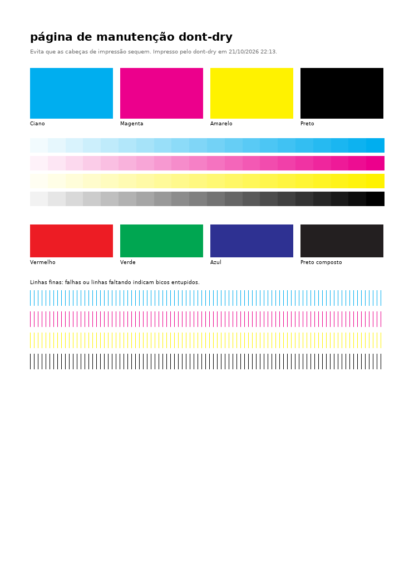

<div align="center">

# dont-dry

**Impede que uma impressora jato de tinta parada entupa: imprime uma pequena página de manutenção num horário programado.**

[](https://github.com/frkey/dont-dry/actions/workflows/ci.yml)
[](LICENSE)
[](pyproject.toml)
[](https://github.com/frkey/dont-dry/pkgs/container/dont-dry)

[English](README.md) · **Português (Brasil)**

[Início rápido](#início-rápido-docker) · [Proxmox](#proxmox-ve-um-container-pronto-em-dois-comandos) · [Configuração](#configuração) · [Problemas comuns](#problemas-comuns) · [Como contribuir](CONTRIBUTING.md)

</div>

Impressora jato de tinta que fica parada entope: a tinta seca nos bicos, e a próxima impressão
sai falhada ou nem sai. O **dont-dry** imprime uma pequena página colorida de manutenção num
horário programado (por padrão, segundas e quintas às 09:00), e assim a tinta continua
circulando.

Ele conversa direto com a impressora por **IPP**, o mesmo protocolo sem driver que o AirPrint e
o Android usam. Por isso funciona com qualquer impressora de rede moderna, não precisa de driver
nem de CUPS e não depende de nuvem do fabricante, como HP ePrint ou Epson Connect (que podem
sumir numa atualização de firmware).

<p align="center"></p>

A página tem blocos sólidos, degradês e cores misturadas de cada tinta, além de linhas finas de
teste de bico: falhas nessas linhas mostram que um bico está começando a entupir.

## Recursos

- **Impressão sem driver** por `ipp://` / `ipps://`, só com a biblioteca padrão do Python e o
  Pillow.
- **Escolhe um formato que a impressora aceita**: PDF, depois PWG Raster (obrigatório em toda
  impressora IPP Everywhere), depois JPEG.
- **Agendamento no estilo cron**, com fuso horário.
- **Não desperdiça tinta**: espera o trabalho terminar e informa o resultado, tenta de novo
  quando a impressora está dormindo ou desligada, e nunca reenvia um trabalho que a impressora
  já aceitou.
- **Níveis de tinta**: avisa quando algum está baixo (se a impressora informar).
- **Notificações** pelo [ntfy](https://ntfy.sh) ou por qualquer webhook.
- **Em português ou inglês**: a página, as notificações e a saída dos comandos saem em
  português com `LOCALE=pt-BR`.
- **Imagem Docker pequena e trancada** (amd64 + arm64): sem root, somente leitura, sem portas
  abertas e com healthcheck. Ou um serviço systemd isolado com um instalador só, e um container
  pronto no Proxmox em [dois comandos](#proxmox-ve-um-container-pronto-em-dois-comandos).

## Início rápido (Docker)

1. **Dê um IP fixo para a impressora** com uma reserva de DHCP no roteador.
2. Confira se o dont-dry enxerga a impressora:

   ```sh
   docker run --rm -e LOCALE=pt-BR -e PRINTER_URI=ipp://192.168.1.50/ipp/print ghcr.io/frkey/dont-dry info
   ```

   ```
   Impressora:       Smart Tank 720  (HP Smart Tank 720 series)
   Estado:           pronta  [none]
   Aceita trabalhos: sim
   Formatos:         application/pdf, image/pwg-raster, image/jpeg, ...
   Tinta:            Cyan: 70%, Magenta: 65%, Yellow: 80%, Black: 55%
   O dont-dry enviaria: application/pdf
   ```

3. Imprima uma página agora:

   ```sh
   docker run --rm -e LOCALE=pt-BR -e PRINTER_URI=ipp://192.168.1.50/ipp/print ghcr.io/frkey/dont-dry print
   ```

4. Deixe rodando no horário programado:

   ```sh
   git clone https://github.com/frkey/dont-dry && cd dont-dry
   cp .env.example .env && chmod 600 .env   # ajuste PRINTER_URI, SCHEDULE, TZ e LOCALE=pt-BR
   docker compose up -d
   docker compose logs -f
   ```

`ghcr.io/frkey/dont-dry:latest` é a última versão publicada (`:edge` acompanha a `master`). Para
gerar a imagem você mesmo: `docker build -t dont-dry .`

### Como achar a URI da impressora

- **HP:** `ipp://<ip>/ipp/print`
- **Epson, Brother, Canon:** quase sempre `ipp://<ip>/ipp/print` também; algumas usam
  `ipp://<ip>/ipp`
- Na dúvida? No Linux, o `ippfind` (pacote `cups-ipp-utils`) lista todas as impressoras IPP da
  rede. Ou abra a página da impressora (digite o IP dela no navegador) e procure as opções de
  AirPrint/IPP.
- Com Docker, use o endereço IP ou um nome que o DNS do seu roteador resolva: nomes `.local`
  (mDNS) não resolvem dentro do contêiner. A [instalação com systemd](#rodando-no-proxmox-ou-no-linux)
  resolve esses nomes.
- Use `ipps://` no lugar de `ipp://` para criptografar a conexão; certificados autoassinados são
  aceitos, a não ser que `TLS_VERIFY=true`.

## Rodando no Proxmox ou no Linux

O dont-dry só precisa alcançar a impressora na porta 631. Se ela estiver em outra VLAN, libere
TCP 631 entre as duas.

### Proxmox VE: um container pronto em dois comandos

No host do Proxmox (o **Shell** do nó na interface web, ou SSH como root):

```bash
curl -fsSLO https://raw.githubusercontent.com/frkey/dont-dry/master/deploy/proxmox/create-lxc.sh
bash create-lxc.sh --locale pt-BR --printer ipp://192.168.1.50/ipp/print
```

Ele cria um container Debian sem privilégios (1 núcleo, 256 MB de RAM, 2 GB de disco, iniciado
no boot, com o fuso horário do host), instala o dont-dry nele como um serviço systemd isolado,
confere se consegue falar com a impressora e mostra os próximos horários de impressão. Sem
`--printer`, ele pergunta o endereço. Se quiser, leia o script antes; ele é curto.

| Opção | Padrão | |
|---|---|---|
| `--printer URI` | *(perguntado)* | a impressora, ex.: `ipp://192.168.1.50/ipp/print` |
| `--schedule CRON` | `0 9 * * 1,4` | quando imprimir, entre aspas |
| `--locale en-US\|pt-BR` | idioma do sistema, senão `en-US` | idioma da página, das notificações e das mensagens |
| `--test-print` | | imprime uma página no fim |
| `--ip dhcp\|CIDR` | `dhcp` | um endereço fixo, ex.: `192.168.1.60/24` |
| `--gateway IP` | | o seu roteador, obrigatório com `--ip` fixo |
| `--ctid N` | próximo ID livre | |
| `--hostname NOME` | `dont-dry` | |
| `--bridge NOME` | `vmbr0` | |
| `--storage NOME` | `local-lvm` | onde fica o disco do container |
| `--template-storage NOME` | `local` | onde fica o template do Debian |
| `--disk GB` | `2` | |
| `--memory MB` | `256` | |
| `--ref BRANCH_OU_TAG` | a última versão | versão do dont-dry a instalar |

No dia a dia, a partir do host do Proxmox:

| Tarefa | Comando |
|---|---|
| Estado da impressora e tinta | `pct exec <id> -- dont-dry info` |
| Imprimir uma página agora | `pct exec <id> -- dont-dry print` |
| Mudar uma configuração | `pct exec <id> -- nano /etc/dont-dry.env`, depois `pct exec <id> -- systemctl restart dont-dry` |
| Acompanhar o log | `pct exec <id> -- journalctl -u dont-dry -f` |
| Atualizar o dont-dry | `pct exec <id> -- env LC_ALL=C.UTF-8 bash /opt/dont-dry/deploy/install.sh` |

### Debian ou Ubuntu: o mesmo instalador

Em qualquer máquina Debian 12+ ou Ubuntu 22.04+ com systemd (um LXC ou VM que você já tem, um
Raspberry Pi), como root:

```bash
curl -fsSLO https://raw.githubusercontent.com/frkey/dont-dry/master/deploy/install.sh
bash install.sh --locale pt-BR --printer ipp://192.168.1.50/ipp/print
```

Ele aceita `--printer`, `--schedule`, `--timezone Area/Cidade` (padrão: o da máquina), `--locale`,
`--test-print` e `--ref`, e grava as configurações em `/etc/dont-dry.env` (só o root lê). Rodar
de novo é como se atualiza: ele mantém a versão e as configurações, e muda só as que você passar
como opção. Como root, `dont-dry info`, `dont-dry print` e `dont-dry next` usam as configurações
do serviço.

Os dois scripts só instalam a última versão quando a tag dela tem a assinatura de releases do
dont-dry, e instalam os pacotes Python em versões exatas, com o hash conferido. O serviço roda
com um usuário temporário que só consegue gravar na própria pasta de estado. Esta instalação
também resolve o nome `.local` da impressora, que continua valendo quando o IP dela muda.

### Docker, num LXC ou numa VM

Num LXC Debian (ligue *Options → Features → nesting*, e *keyctl* em contêineres sem privilégio)
ou numa VM, instale o Docker e siga o [início rápido](#início-rápido-docker):

```sh
apt update && apt install -y curl git
curl -fsSL https://get.docker.com | sh
```

Se você já roda Docker, acrescente o serviço do [`docker-compose.yml`](docker-compose.yml) à sua
stack.

## Configuração

Todas as opções são variáveis de ambiente (veja o [`.env.example`](.env.example)). O dont-dry
confere todas ao iniciar e para com uma mensagem clara se alguma estiver errada.

| Variável | Padrão | Descrição |
|---|---|---|
| `PRINTER_URI` | *(obrigatória)* | ex.: `ipp://192.168.1.50/ipp/print` |
| `SCHEDULE` | `0 9 * * 1,4` | Expressão cron: minuto hora dia-do-mês mês dia-da-semana. Nomes (`mon`, `jan`), intervalos, listas, passos e atalhos como `@weekly` funcionam. As impressões precisam ficar a pelo menos 3 horas uma da outra. |
| `TZ` | `UTC` | Fuso horário do agendamento, ex.: `America/Sao_Paulo` |
| `RUN_ON_START` | `false` | Imprime uma vez assim que o agendador inicia (não se uma página chegou à impressora na última hora) |
| `CATCH_UP` | `true` | Se a última impressão agendada não chegou à impressora (a máquina ou a impressora estava desligada), imprime uma vez ao iniciar |
| `PAGE_SIZE` | `a4` | `a4` ou `letter` |
| `LOCALE` | `en-US` | Idioma da página, das notificações e da saída dos comandos: `en-US` ou `pt-BR` |
| `PAGE_TITLE` | `dont-dry maintenance page` | Título impresso na página (o padrão segue o `LOCALE`: `página de manutenção dont-dry` em pt-BR) |
| `DOCUMENT_FORMAT` | `auto` | `auto`, `application/pdf`, `image/pwg-raster` ou `image/jpeg` |
| `CUSTOM_PAGE` | | Caminho de um PDF, PNG ou JPEG seu para imprimir no lugar (imagens são ajustadas à página) |
| `RETRIES` | `3` | Tentativas extras quando a impressora não responde (0 a 20) |
| `RETRY_DELAY` | `300` | Segundos entre as tentativas |
| `JOB_TIMEOUT` | `300` | Segundos de espera para o trabalho terminar |
| `LOW_INK_THRESHOLD` | `10` | Avisa quando uma tinta está nesta porcentagem ou abaixo |
| `NOTIFY_URL` | | URL que recebe um POST em texto simples, ex.: `https://ntfy.sh/meu-topico` |
| `NOTIFY_TOKEN` | | Token *bearer* opcional para a URL de notificação |
| `NOTIFY_ON` | `failure` | `failure` (também tinta baixa), `always` ou `never` |
| `TLS_VERIFY` | `false` | Verifica o certificado da impressora em `ipps://` |
| `LOG_LEVEL` | `INFO` | `DEBUG`, `INFO`, `WARNING` ou `ERROR` |
| `STATE_DIR` | `~/.local/state/dont-dry` | Onde ficam o heartbeat e o `last-run.json` (`/tmp/dont-dry` na imagem; o `docker-compose.yml` usa um volume em `/var/lib/dont-dry`) |

Só há nova tentativa quando o trabalho nem chegou à impressora (ela estava dormindo, desligada,
ocupada ou sem aceitar trabalhos). Se a impressora aceitou o trabalho e depois o abortou, o
dont-dry informa a falha em vez de gastar outra folha. Seja qual for o motivo (um reinício, o
relógio voltando, a hora que se repete no fim do horário de verão), o dont-dry nunca imprime de
novo menos de uma hora depois de uma página que chegou à impressora.

### Notificações

Com o [ntfy](https://ntfy.sh), escolha um tópico longo e aleatório (quem souber o nome consegue
ler), defina `NOTIFY_URL=https://ntfy.sh/<tópico>` e assine o tópico no app do ntfy. As falhas
chegam com prioridade alta; uma impressão bem-sucedida só notifica quando alguma tinta está
baixa, a não ser que `NOTIFY_ON=always`. Qualquer outro webhook que aceite um POST em texto
simples também serve; o título vai no cabeçalho `Title`.

## Comandos

```
dont-dry run            # agendador (o padrão do contêiner)
dont-dry print          # imprime agora (--retry para tentar de novo como o agendador)
dont-dry info           # estado da impressora, formatos aceitos, níveis de tinta
dont-dry next -n 5      # próximos horários de impressão para SCHEDULE/TZ
dont-dry render out.pdf # salva a página de teste localmente (.pdf, .png, .jpg ou .pwg)
dont-dry healthcheck    # sai com 0 se o agendador está vivo (usado pela imagem)
```

Com Docker: `docker compose exec dont-dry dont-dry info`, ou `docker compose run --rm dont-dry next`.

## Problemas comuns

| Mensagem | O que fazer |
|---|---|
| `cannot reach printer at ...` | Confira o IP, se a impressora está ligada e se a porta TCP 631 está liberada entre o dont-dry e ela. Impressoras dormindo costumam acordar até a próxima tentativa. |
| `lost the printer's answer ...; the page may have printed, so it was not sent again` | A página foi enviada, mas a impressora não confirmou (desligou a conexão ou demorou mais de dois minutos para responder). Confira a bandeja antes de imprimir de novo à mão. |
| `printer answered HTTP 404` | O caminho está errado: tente `/ipp/print`, depois `/ipp`. |
| `printer supports none of application/pdf, image/pwg-raster, image/jpeg` | A impressora não imprime sem driver (IPP Everywhere / AirPrint), então o dont-dry não consegue falar com ela. |
| `printer rejected the job: client-error-document-format-not-supported` | Defina `DOCUMENT_FORMAT` com outro formato que o `dont-dry info` liste. |
| `job N processing (still processing after 300s)` | A impressora estava ocupada, por exemplo limpando as cabeças. Aumente o `JOB_TIMEOUT`. |
| `printer is not accepting jobs (...)` | A impressora está pausada ou mostra um erro no painel (os motivos entre parênteses dizem qual). Resolva lá; o dont-dry tenta de novo sozinho. |
| `A versão vX.Y.Z não está assinada com a chave de releases do dont-dry` | O instalador recusou uma versão que não conseguiu conferir, e nada mudou. Por favor, avise: isso não deveria acontecer. |
| `a page reached the printer N minutes ago; not printing again so soon` | Não há nada errado: uma página saiu há menos de uma hora (logo antes de um reinício, ou impressa à mão), então esta foi pulada. `dont-dry print` imprime mesmo assim. |
| `SCHEDULE ... less than 3 hours apart` | Confira os campos de minuto e hora: `* 9 * * 1` é a cada minuto das 09:00 às 09:59; `0 9 * * 1` é às 09:00 de segunda. |
| O contêiner fica `unhealthy` | Leia `docker compose logs dont-dry`: o agendador parou ou não consegue gravar o heartbeat em `STATE_DIR`. |
| Linhas faltando ou falhadas na página | É para isso que a página serve: rode a limpeza de cabeça pelo menu ou app da impressora e depois `dont-dry print`. Se continuar acontecendo, imprima com mais frequência. |

As mensagens acima aparecem nos logs e na linha "Detalhes" das notificações, que ficam sempre em
inglês para facilitar a busca. Para mais detalhes, use `LOG_LEVEL=DEBUG`.

## Com que frequência imprimir?

Os fabricantes costumam recomendar imprimir pelo menos uma vez por semana para manter as cabeças
saudáveis. Duas vezes por semana (o padrão) deixa uma folga. Em clima seco, ou se as linhas de
teste de bico começarem a mostrar falhas, imprima com mais frequência.

## Segurança

O dont-dry não abre nenhuma porta: ele só se conecta à impressora e, se configurada, à URL de
notificação. A imagem roda com um usuário sem root e sistema de arquivos somente leitura, e o
serviço systemd é isolado. Veja o [SECURITY.md](SECURITY.md) (em inglês) para o que ele protege,
os limites conhecidos e como relatar uma vulnerabilidade.

## Como contribuir

Relatos de bugs, relatos de impressoras ("funciona na minha Epson L3250") e pull requests são
bem-vindos. Veja o [CONTRIBUTING.md](CONTRIBUTING.md) (em inglês). Os testes rodam contra uma
impressora IPP falsa no próprio processo, então não precisa de hardware:

```sh
python -m venv .venv && . .venv/bin/activate
pip install -e ".[dev]"
pytest
```

## Licença

[MIT](LICENSE)
